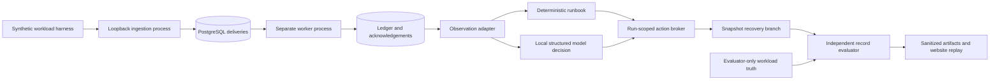

# Architecture and decisions

## 01 — Database and event identity

PostgreSQL gives the lab actual process-independent transactions and row locks.
The first version does not need a second message broker. The durable delivery
table is a bounded queue; acknowledgements are separate rows. Its faulty worker
commits an effect before acknowledging delivery. An interruption in that gap
leaves an ambiguous delivery that an ordinary restart processes again.

The safe path takes a row lock for the run, checks the envelope and an effect
identity table, writes the business entry, and acknowledges in one transaction.
It deliberately prioritizes correctness and inspectability over parallel
throughput. Two safe workers serialize on a run. Separate runs can proceed
independently. Database isolation and unique constraints establish the contract;
there is no claim of exactly-once networking.

Identity is `(tenant,event_id)`, not order ID. Different tenants can use the same
event ID. A sale and a refund on one order are distinct legitimate events.
Amounts are bounded integer cents in USD. Unsupported units remain in quarantine;
the system never guesses a conversion. A changed payload for an existing identity
is held for review rather than silently replacing the first accepted payload.

## 02 — Branching and replay

A captured snapshot contains raw deliveries, entries, acknowledgements, effects,
quarantine, mode, cancellation, and revision. A branch copies this business state
while holding the source run lock. Branch initial hashes must match the incident
hash. Receipt history is branch-local and intentionally excluded.

This is logical database-state branching. It is not a VM snapshot, a promise of
identical thread scheduling, deterministic LLM text, or rollback of an external
payment. The source-state hash is checked again after branch execution.

## 03 — Investigator authority

The model receives a bounded observation document and a JSON schema. It selects
one action and identifies supporting observations. The host adds run and request
identities. The broker accepts a closed envelope and fixed operations only.
Unknown keys, cross-run requests, unknown operations, cancelled runs, expired
budgets, and mismatched idempotency keys are rejected before mutation.

Repairs first commit a pending receipt and corrected processing mode. A retry of
that request resumes pending work. Completed requests return their retained
receipt. Worker actions check cancellation between records and a monotonic time
budget. SQL statement and lock waits are also bounded. An in-flight transaction
may complete before cancellation takes effect.

The LLM performs a constrained one-step decision, not unrestricted exploration.
This intentionally measurable boundary makes it possible to compare its decision
against a deterministic runbook using identical observations and operations.

## 04 — Independent truth

The workload generator establishes expected business records before adding a
duplicate delivery or malformed envelope. It stores expected quarantine positions
in evaluator-only truth. The evaluator does not import worker validation or repair
code. It checks uniqueness, completeness, identity/amount equality, and exact
quarantine membership. Opposing amount errors cannot pass merely by cancelling
out in the total. Incomplete processing is not success.

The harness and evaluator are separate Python modules and data flows, not a
security boundary against a malicious local administrator. The model boundary
is enforced by the observation adapter and fixed request format.

## 05 — Website

The portfolio hosts static JSON exports and a React replay viewer. Visitors choose
an incident, advance or rewind its recorded states, compare recovery branches,
and inspect records, checks, source excerpts, and evaluation results. The browser
does not claim to start a fresh local process or model. This makes the evidence
available when the workstation is off and avoids exposing private infrastructure.

## References

- [PostgreSQL transaction isolation](https://www.postgresql.org/docs/17/transaction-iso.html)
- [Psycopg basic usage](https://www.psycopg.org/psycopg3/docs/basic/usage.html)
- [Ollama structured outputs](https://docs.ollama.com/capabilities/structured-outputs)
- [Microsoft AIOpsLab](https://github.com/microsoft/AIOpsLab), related work in reproducible incident evaluation

This implementation is original project code; it does not copy the AIOpsLab
implementation or claim to introduce incident injection or AI troubleshooting.
